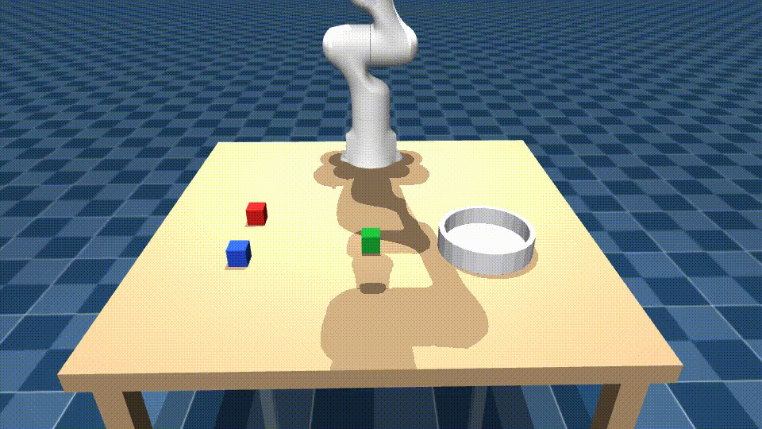

# Lang2Act

**A simulated Franka Panda arm that takes a typed command, carries it out, and tells you whether it worked or why it didn't.**




```
$ lang2act run "put the red cube in the bowl" --viewer

Carried out 5 of 5 steps:
  - move_to(target=red_cube, offset_z=0.15) ok
  - grasp(target=red_cube) ok
  - lift(height=0.15) ok
  - place(target=bowl) ok
  - release() ok
Outcome: success.
```

LLMs can describe what to do but cannot be trusted to output joint angles. Classical controllers execute precisely but cannot read intent. Lang2Act joins the two with a strict split:

> **the LLM decides _what_, deterministic code decides _how_, and the simulator's state decides _whether it worked_.**

---

## Contents

- [How it works](#how-it-works)
- [Install](#install)
- [Run it](#run-it)
- [Choosing an LLM](#choosing-an-llm)
- [Evaluation](#evaluation)
- [Results](#results)
- [Repository layout](#repository-layout)
- [Design decisions](#design-decisions)
- [Limitations](#limitations)
- [Troubleshooting](#troubleshooting)
- [Status against the build plan](#status-against-the-build-plan)

---

## How it works

Three layers. Everything above a line can be wrong without breaking anything below it.

```
            "put the red cube in the bowl"
                         |
   +---------------------v----------------------+
   |  PLANNER  (the LLM — allowed to be wrong)  |   planner.py
   |  scene text + skill docs -> JSON plan      |
   +---------------------+----------------------+
                         |  JSON
   +---------------------v----------------------+
   |  VALIDATOR  (schema, object enum, limits)  |   planner.py
   |  a bad plan is rejected before anything    |
   |  moves; the error is fed back once         |
   +---------------------+----------------------+
                         |  validated Plan
   +---------------------v----------------------+
   |  EXECUTOR  (verifies every step)           |   executor.py
   |  retries grasp slips, re-plans once        |
   +---------------------+----------------------+
                         |  skill calls
   +---------------------v----------------------+
   |  SKILLS  move_to grasp lift place release  |   skills.py
   |  each returns {ok, reason} and checks its  |
   |  own postcondition from sim state          |
   +---------------------+----------------------+
                         |  IK + min-jerk trajectories
   +---------------------v----------------------+
   |  ROBOT / SCENE  (MuJoCo, mink IK)          |   robot.py, scene.py
   +---------------------+----------------------+
                         |  object poses, contacts
   +---------------------v----------------------+
   |  DESCRIBER  sim state -> text              |   describe.py
   +--------------------------------------------+
                  (feeds the planner)
```

### The plan schema

The planner may only return this shape. Object names are checked against an enum built from the **current** scene, so the model cannot reference a cube that does not exist.

```json
{
  "status": "plan",
  "question": null,
  "reason": null,
  "steps": [
    {"skill": "move_to", "target": "red_cube", "offset_z": 0.15},
    {"skill": "grasp",   "target": "red_cube"},
    {"skill": "lift",    "height": 0.15},
    {"skill": "place",   "target": "bowl"},
    {"skill": "release"}
  ]
}
```

`status` is one of:

| status | meaning | effect |
| --- | --- | --- |
| `plan` | a list of steps to run | executed, step by step, verified |
| `clarify` | ambiguous in **this** scene | the question is asked, **nothing moves** |
| `infeasible` | names something absent, or impossible | the reason is reported, **nothing moves** |

A `place` step takes either a `target` (`bowl`, or another cube to stack on) **or** a `relation` + `reference` (`left_of` / `right_of` / `behind` / `in_front_of` a named object) — never both, never neither.

### The skill contract

Each skill returns `{ok: bool, reason: str}` and proves its own effect from simulator state:

| skill | postcondition checked |
| --- | --- |
| `move_to(target, offset_z)` | TCP within 10 mm of the commanded pose |
| `grasp(target)` | **both** finger pads in contact, jaws not closed on air |
| `lift(height)` | object ≥ 3 cm clear of the table **and** still held |
| `place(target \| relation+reference)` | object horizontally inside the target **and** still held |
| `release()` | object out of the gripper, and settled inside the target `place` aimed at |

Failure reasons are a closed vocabulary — `unreachable`, `motion_error`, `grasp_slip`, `object_dropped`, `place_blocked`, `not_in_target`, `object_stuck`, `unknown_object`, `not_graspable`, `already_holding`, `nothing_held` — so the evaluation can group by them.

### Failure handling

- A **slipped grasp** backs off, re-reads the cube's pose (a slip is almost always a nudged cube) and tries again, up to twice.
- Any **other mid-plan failure** triggers exactly one re-plan from the state the arm is actually in — including what it is still holding.
- An **ambiguous** command is never guessed at, and an **impossible** one is never attempted.

---

## Install

Requires Python ≥ 3.10, a CPU-only Linux/macOS machine, and a display for the live viewer (video recording also needs one — see [Troubleshooting](#troubleshooting)).

```bash
git clone <your-repo-url> lang2act && cd lang2act
git submodule update --init --depth 1 third_party/mujoco_menagerie

python3 -m venv .venv && source .venv/bin/activate
pip install -e .                      # core: mujoco, mink, pydantic, imageio
pip install -e ".[dev]"               # + pytest
pip install -e ".[anthropic]"         # + the Claude SDK, when you want a real planner
```

> The Panda model comes from [MuJoCo Menagerie](https://github.com/google-deepmind/mujoco_menagerie) as a git submodule. A sparse checkout of just `franka_emika_panda` is enough (~44 MB); a full clone also works.

Check the install:

```bash
pytest                                # ~90 tests, about 10 seconds
lang2act view --seed 3 --viewer       # the scene, in the MuJoCo viewer
```

---

## Run it

Every subcommand takes `--seed N` (the scene is deterministic in the seed), and the ones that move the arm take `--viewer` to watch live and `--video PATH` to save an MP4 from the fixed front camera.

```bash
# Look at a scene and read what the planner would be told about it
lang2act view --seed 3 --viewer

# Phase 1 gate: TCP accuracy over 20 random reachable points
lang2act ik-test --points 20 --seed 2

# Phase 2 gate: every cube into the bowl, hard-coded skill calls, no LLM
lang2act pick --seed 2 --viewer
lang2act pick --seed 2 --video results/pick.mp4

# One natural-language command, planned and executed
lang2act run "put the red cube in the bowl" --viewer
lang2act run "put all the cubes in the bowl" --video results/demo.mp4
lang2act run "pick up the cube"                      # asks which one
lang2act run "put the purple cube in the bowl"       # refuses, with a reason
lang2act run "move the blue cube to the left of the green cube"

# The frozen 30-command evaluation
lang2act eval --seeds 3
```

The `scripts/` entry points from the build plan do the same things:

```bash
python scripts/01_view_scene.py --seed 3 --viewer
python scripts/02_ik_test.py --points 20
python scripts/03_scripted_pick.py --seed 2 --viewer
python scripts/run_command.py "put the red cube in the bowl" --viewer
```

Useful extras on `lang2act run`: `--json PATH` writes the full episode log, `--llm PROVIDER` picks the planner, `--no-replan` disables the single re-plan so you can see raw failures.

---

## Choosing an LLM

The provider sits behind one interface, so swapping models is a config change:

```bash
export ANTHROPIC_API_KEY=...
lang2act run "put the red cube in the bowl" --llm anthropic
lang2act run "put the red cube in the bowl" --llm anthropic:claude-opus-5-5
lang2act eval --seeds 3 --llm anthropic          # the number that counts

# or set it once
export LANG2ACT_LLM=anthropic:claude-opus-5-5
export LANG2ACT_LLM_CACHE=1                      # cache responses on disk while iterating
```

| `--llm` | backend | notes |
| --- | --- | --- |
| `anthropic[:model]` | Claude via the official SDK | uses structured output, so plans are schema-valid by construction. Default model `claude-opus-5-5` |
| `openai[:model]` | OpenAI chat completions | JSON mode; for the two-model comparison |
| `ollama[:model]` | a local model over Ollama | no API key, no network; the fallback when hosted access is a problem |
| `mock` *(default)* | a rule-based stand-in | **not a language model** — see below |

### About the `mock` planner

`mock` is a deterministic, regex-based stand-in that pattern-matches commands instead of understanding them. It exists so that the executor, the skills, the goal checks and the whole eval harness can be developed and run with **no API key and no network**.

It is not the deliverable, and **its success rate is not a language-understanding result** — it was written against the same command categories it is scored on. Treat `mock` numbers as a measurement of the *robot stack*: IK, grasping, placement, verification and the goal checks. Report headline numbers from a real model, and say which one.

---

## Evaluation

```bash
lang2act eval --seeds 3                      # all 30 commands, 3 seeds each
lang2act eval --seeds 3 --llm anthropic
lang2act eval --category relational --seeds 1
lang2act eval --id simple_01 --video         # record the first seed
```

The test set is `eval/commands.yaml`: **30 commands, frozen before any prompt tuning.** Tuning the prompt against commands you also score on is how you end up reporting a number that means nothing.

| Category | Count | Example | Goal check |
| --- | --- | --- | --- |
| Simple placement | 8 | *put the red cube in the bowl* | red cube inside the bowl radius, below the rim |
| Paraphrase / synonyms | 6 | *drop the crimson block into the dish* | same as above |
| Relational | 6 | *move the cube nearest the bowl to the left of the green one* | target cube's `y` exceeds the reference's by ≥ 3 cm |
| Multi-object | 4 | *put all the cubes in the bowl* | every cube inside the bowl |
| Ambiguous | 3 | *pick up the cube* | a clarifying question was asked **and no cube moved** |
| Infeasible | 3 | *put the purple cube in the bowl* | refused with a reason **and no cube moved** |

Goals are machine-checkable and independent of the executor. "The cube nearest the bowl" is resolved against the **starting** layout — scene generation is deterministic in the seed, so the goal is fixed before the episode runs and cannot drift as the robot moves things. A guard rejects degenerate cases (a goal that resolves to its own reference) before the run starts.

Each run writes:

```
results/<run-id>/
  episodes/<case>_seed<N>.json   command, seed, scene text, raw LLM output, parsed plan,
                                 every step's result, retries, final state, outcome,
                                 failure reason, wall time, tokens
  summary.json                   machine-readable aggregate
  summary.md                     the table below
```

### Failure breakdown by layer

Every failure is attributed to one of three layers — the most interesting thing the report produces:

- **planner** — a schema-invalid plan, a plan naming the wrong object, or the wrong status (executing an ambiguous command, refusing a feasible one). Also: every step verified yet the goal was not met, which means the plan was wrong.
- **controller** — a good plan the arm failed to carry out (`grasp_slip`, `motion_error`, `unreachable`, …).
- **perception** — the scene description was wrong. **In v1 this is 0 by construction**: the describer and the goal check read the same simulator state, so they cannot disagree. The category exists because it becomes real the moment object poses come from a camera instead.

---

## Results

### Phase 1 — IK and scripted pick (no LLM involved)

Measured on this machine, `lang2act ik-test --points 20` over seeds 0–4:

| Metric | Result | Gate |
| --- | --- | --- |
| Reachable targets | 100/100 | — |
| Mean TCP error | **0.42 – 0.66 mm** | < 5 mm |
| Max TCP error | **1.27 mm** | < 5 mm |
| Scripted pick, all 3 cubes, seeds 0–4 | **5/5 PASS** | all cubes in the bowl |

Error here is end-to-end: the IK solution *and* the servo tracking it. Gravity compensation (`gravcomp=1` on the arm bodies) is what keeps it sub-millimetre; without it the arm sags 6–8 mm below the target under a pure position servo.

### End-to-end, 30-command set

`lang2act eval --seeds 3`, 90 episodes:

| Planner | Success | Plan validity | Mean wall time |
| --- | --- | --- | --- |
| `mock` (rule-based stand-in) | **90/90 (100%)** | 100% | 0.96 s / episode |
| `anthropic:claude-opus-5-5` | *not yet run — needs an API key* | | |

> **Read the mock row as a robot-stack result, not a language result.** It says the IK, grasping, placement, verification, retry logic and goal checks are sound across all 30 commands and 3 seeds, with zero grasp failures. It says nothing about language understanding, because the stand-in was written against these categories. The row that belongs in a CV is the one from a real model; run `lang2act eval --seeds 3 --llm anthropic` to fill it in.

Two real bugs were found by this harness and fixed, which is the point of having it:

1. A relational `place` lowered the cube to ~4 mm above the table, so it touched down before the arm reached the commanded pose and tripped the tracking check. The drop now leaves the same 12 mm gap the bowl placement uses.
2. After a failed `place`, the re-plan was not told the gripper was still holding a cube, so the new plan tried to grasp again and failed with `already_holding`. The re-plan prompt now states what is held.

---

## Repository layout

```
lang2act/
├── README.md
├── pyproject.toml
├── third_party/mujoco_menagerie/   # git submodule: the Panda model
├── src/lang2act/
│   ├── scene.py       # MjSpec scene builder, seeds, randomisation, state queries
│   ├── robot.py       # IK (mink), min-jerk motion, gripper, contacts, viewer/video hooks
│   ├── skills.py      # move_to, grasp, lift, place, release + postcondition checks
│   ├── describe.py    # sim state -> text for the planner
│   ├── planner.py     # prompt, plan schema, validation, LLM backends
│   ├── executor.py    # runs a plan, verifies each step, retries, re-plans, reports
│   ├── eval.py        # the frozen test set, goal checks, logs and summary tables
│   └── cli.py         # the `lang2act` command
├── scripts/           # 01_view_scene, 02_ik_test, 03_scripted_pick, run_command
├── tests/             # ~90 tests, under 15 seconds
├── eval/commands.yaml # the frozen 30-command set
└── results/           # generated: per-episode JSON, summary tables, videos (gitignored)
```

---

## Design decisions

Each of these cost time to discover, so they are written down.

- **The scene is built with `MjSpec` in Python, not hand-written XML.** `<include>`-ing Menagerie's `panda.xml` from your own XML breaks its relative mesh paths. Building the spec in code also makes per-seed randomisation trivial.
- **Menagerie's `home` keyframe is deleted and rebuilt.** Once free-floating cubes are added, its `qpos` no longer matches the model.
- **A `tcp` site sits on the `hand` body, 0.1034 m out** — Franka's flange-to-fingertip distance. All IK targets this site, not the flange.
- **IK runs on a robot-only model** (`build_scene(with_objects=False)`), so the differential-IK solver can never "satisfy" a target by sliding a free-floating cube.
- **IK is solved offline, then tracked.** mink solves for a joint configuration; a min-jerk interpolation drives the position actuators there. Physics is never stepped inside the IK loop, which keeps motion deterministic given a seed.
- **`gravcomp=1` on the arm bodies.** Without it the arm sags 6–8 mm below its IK target. Verified: mean error drops to ~0.5 mm.
- **`actuator8` drives the finger tendon: 255 = open, 0 = closed.**
- **The bowl is static and built from a disc plus a 24-segment wall ring.** In v1 it is a *target region*, not something to push around, and a fixed region makes the `place` postcondition a clean geometric test.
- **Multi-object placement picks a free slot.** Three slots on a small circle inside the bowl, far enough apart that three 4 cm cubes sit side by side instead of stacking out over the rim, and close enough in that the fingers clear the wall on the way down.
- **`+y` is the robot's left, `+x` is away from the base, `z = 0` is the table top.** This convention is stated in the prompt and used by every relational goal check.

---

## Limitations

Honest list of what this does not do and where it breaks.

- **No vision.** Object poses are read from the simulator. The `perception` failure category is therefore structurally empty in v1; it only becomes meaningful with a camera.
- **No real hardware, no ROS, no sim-to-real.** Contact parameters are tuned for a stable sim, not matched to a real Panda.
- **No learned policies.** Everything below the planner is scripted.
- **Rigid objects only.** No drawers, cloth, or articulated objects.
- **Collision avoidance is not planned.** Motions are straight joint-space interpolations with a fixed carry height. Cluttered scenes can clip; the tracking check catches it as `motion_error` rather than preventing it.
- **`place` relations are fixed 12 cm offsets.** "Left of" means 12 cm in `+y`, not "adjacent and aligned".
- **The workspace is small** — roughly `x ∈ [0.34, 0.62]`, `y ∈ [-0.32, 0.32]`. Relational placements near the edge can be unreachable, and are reported as `place_blocked`.
- **One re-plan, two grasp retries.** Deliberate ceilings; deeper recovery is out of scope for v1.
- **The headline number depends on which model plans.** See [About the `mock` planner](#about-the-mock-planner).

---

## Troubleshooting

**The viewer or `--video` fails with an OpenGL error.** Rendering needs a GL context. On a desktop session the default (GLFW) works. Headless, install OSMesa and use software rendering:

```bash
sudo apt install libosmesa6-dev
MUJOCO_GL=osmesa lang2act run "put the red cube in the bowl" --video results/demo.mp4
```

Headless runs **without** `--viewer` or `--video` need no GL at all — the eval runs fine on a bare server.

**`mink` cannot find a QP solver.** `pip install qpsolvers[daqp]`, or any of `quadprog` / `osqp`. The code asks for `daqp`, which ships with `qpsolvers`.

**`FileNotFoundError` for `panda.xml`.** The submodule is not checked out: `git submodule update --init --depth 1 third_party/mujoco_menagerie`.

**The arm sags below its target.** `SceneConfig.gravity_compensation` is False, or you built the model without it.

**Planning fails with `no JSON object found`.** The model replied in prose. The planner already re-prompts once with the validation error; if it still fails the episode is logged as `invalid_plan` with the raw text in `plan_attempts`, which is the first place to look.

---

## Status against the build plan

| Phase | Scope | Status |
| --- | --- | --- |
| **1** | Scene, IK, scripted pick, `--viewer` / `--video` | ✅ gates pass (IK < 1.3 mm worst case; pick 5/5 seeds) |
| **2** | 5 skills with postcondition checks, scene describer, unit tests | ✅ scripted pick rewritten as skill calls and still passes |
| **3** | LLM planner, validator, executor, `run_command.py` | ✅ built; **run the 10-command demo and record the video with a real model** |
| **4** | Grasp retries, clarify/infeasible paths, one re-plan | ✅ built and tested |
| **5** | Frozen 30-command eval, per-episode logs, summary tables, layer breakdown | ✅ harness complete; **re-run with a real model for the reported number** |
| **6** | Ship: README with results, demo video, write-up | 🔜 clip embedded at the top; the 10-command reel and the write-up are outstanding |

**Next steps, in order:**

1. `export ANTHROPIC_API_KEY=...` and run `lang2act eval --seeds 3 --llm anthropic`. Paste the resulting `summary.md` table into [Results](#results).
2. Extend the clip at the top into the full 1–2 minute reel across 10 commands (`lang2act run "..." --video`), so it also shows the relational placements, the clarifying question and the refusal. Convert it to `docs/demo.gif` — that is the file GitHub actually plays.
3. Run the same frozen set on a second model and report success, cost per command and latency side by side.

---

## License

Apache License 2.0 — see [LICENSE](./LICENSE). The Franka Panda model is from [MuJoCo Menagerie](https://github.com/google-deepmind/mujoco_menagerie) and carries its own license.
